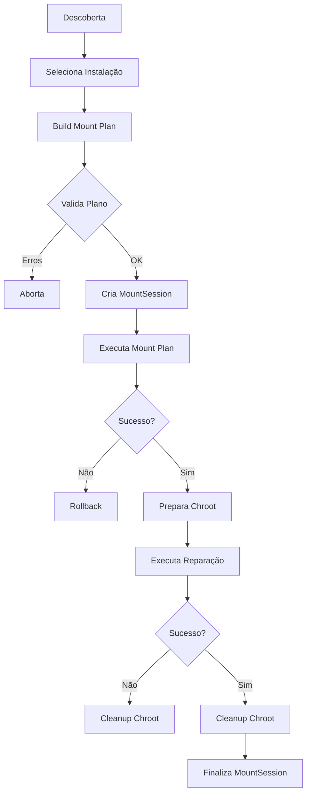

# CHROOT - Ambiente de Recuperação

## Visão Geral

O ambiente chroot (change root) permite executar comandos dentro de um sistema de arquivos target como se fosse a raiz do sistema. É essencial para reparação de boot pois permite:

- Reinstalar/regenerar bootloader (GRUB, systemd-boot, Limine)
- Regenerar initramfs (mkinitcpio, dracut)
- Reparar configurações (/etc/fstab, /etc/default/grub, etc.)
- Instalar/atualizar pacotes (pacman)

## Preparação do Ambiente

### Pseudo-Filesystems Obrigatórios

| Source | Target | Tipo | Necessário para |
|--------|--------|------|-----------------|
| `/dev` | `<root>/dev` | devtmpfs | `grub-install`, `cryptsetup`, device access |
| `/proc` | `<root>/proc` | proc | `grub-mkconfig`, kernel params |
| `/sys` | `<root>/sys` | sysfs | `grub-install`, firmware info |
| `/run` | `<root>/run` | tmpfs | systemd, lockfiles, sockets |

### Montagem

```bash
mount --rbind /dev  /mnt/dev
mount --rbind /proc /mnt/proc
mount --rbind /sys  /mnt/sys
mount --rbind /run  /mnt/run
```

### Detecção de Pré-existentes

Antes de montar, verifica se já está montado:
```bash
findmnt -n -o TARGET /mnt/dev
```

Se já montado, **não desmonta na limpeza**.

## Entrada no Chroot

```bash
chroot /mnt /bin/bash
# ou comando direto:
chroot /mnt grub-install /dev/sda
```

### Variáveis de Ambiente

Mínimas necessárias:
- `PATH=/usr/bin:/usr/sbin:/bin:/sbin`
- `TERM` (para output colorido)
- `LANG=C` (locale consistente)

### Diretório de Trabalho

Padrão: `/` (raiz do chroot)
Pode ser alterado: `chroot /mnt /bin/bash -c "cd /boot && ls"`

## Operações Comuns de Reparação

### GRUB (BIOS)
```bash
grub-install --target=i386-pc /dev/sda
grub-mkconfig -o /boot/grub/grub.cfg
```

### GRUB (UEFI)
```bash
grub-install --target=x86_64-efi --efi-directory=/boot/efi --bootloader-id=GRUB
grub-mkconfig -o /boot/grub/grub.cfg
```

### systemd-boot
```bash
bootctl --path=/boot/efi install
# ou
bootctl --path=/boot install  # se ESP em /boot
```

### Limine
```bash
limine-install /dev/sda  # BIOS
limine-install --uefi /boot/efi  # UEFI
```

### Initramfs (Arch/CachyOS - mkinitcpio)
```bash
mkinitcpio -P  # todos os presets
mkinitcpio -p linux  # preset específico
```

### Initramfs (Fedora - dracut)
```bash
dracut --regenerate-all --force
dracut --force  # kernel atual
```

## Validação do Ambiente

Antes de reparar, verificar:

```bash
# Ferramentas essenciais
which bash mount cryptsetup grub-install

# Bootloader específico
which grub-install      # GRUB
which limine-install    # Limine

# Initramfs
which mkinitcpio        # Arch
which dracut            # Fedora

# Kernel/initramfs existentes
ls /boot/vmlinuz*
ls /boot/initramfs*
```

## Segurança

### Confinamento
- Todas as operações dentro de `<root_mount>`
- Montagens confinadas ao root_mount
- Não acessa host filesystem exceto pseudo-fs

### Não Destrutivo
- **Não copia `/etc/resolv.conf`** do host
- **Não desmonta recursos pré-existentes**
- **Rollback automático** em falha

### Sanitização
- Logs não contêm senhas/tokens
- Argumentos sensíveis não logados
- Saída de comandos sanitizada

## Fluxo Completo de Reparação



## Limitações

1. **Requer root** - montagem e chroot precisam privilégios
2. **Não funciona em containers** sem CAP_SYS_ADMIN + CAP_SYS_CHROOT
3. **Kernel deve suportar** filesystems do target
4. **Arch/CachyOS only** - mkinitcpio específico; dracut para Fedora
5. **ESP location** - não assume `/boot/efi`; detecta via fstab/mounts

## Testes

- Unitários: configuração, validação, estruturas de dados
- Integração: com diretórios temporários, **sem chroot real**
- Mocks para `Command::new("chroot")` em testes de execução